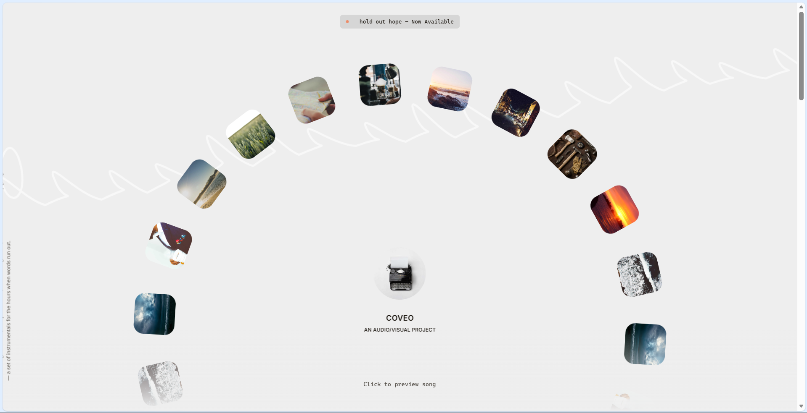

# Third UI · COVEO — 音视频作品集（交互机制复刻）

> Vue 3 + Vite 单页应用，复刻「环形唱片墙 + 鼠标拖尾画廊」的交互机制：22 项唱片环形自转、Lenis 平滑滚动、常驻试听播放器与专辑内页。



## 核心机制

| 机制 | 实现方式 |
| --- | --- |
| 环形唱片墙 | 11 张专辑 × 2 份（对侧 180° 重复）共 22 项，沿环形分布；整环 120s 无限自转，悬停时按角距衰减放大（振幅 0.15 / 衰减 0.33） |
| 新专光环 | 按发行时间判定「近 4 个月」的专辑点亮光环；`?demo=featured` 可把窗口放宽到 24 个月用于观察 |
| 拖尾画廊 | 鼠标移动与滚动双触发：30 张封面在指针轨迹上淡入淡出（存活 250ms、进出场 450/750ms、随机旋转 ±25°），停手后自动演示 |
| 平滑滚动 | Lenis（lerp 0.3）+ 元素级视差档位（`data-speed`） |
| 试听播放器 | 常驻底部播放器：假计时 30s、波形可视化、上下曲切换；换页不重建 |
| 路由 | history 模式：`/` 首页，`/:id` 由单条动态路由承接 11 个专辑 slug；`scrollBehavior` 统一回顶部 |
| 可复用组件 | `packages/ring-gallery`、`packages/cursor-trail` 各自带 `demo.html`，可脱离页面单独运行 |

## 技术栈

- Vue 3.5 + vue-router（history 模式）
- Lenis 平滑滚动
- Vite（3 个构建入口 + `manualChunks` 分包）
- 原生 CSS（设计令牌 `tokens.css` / 基础层 / 动画层三层拆分）

## 目录结构

```
thirdUI/
├─ index.html               SPA 挂载点（含 SEO / OG 基线）
├─ vite.config.js           多入口（主应用 + 2 个组件 demo）/ 别名 / 分包
├─ package.json
├─ src/
│  ├─ main.js               引导：按顺序注入样式后挂载
│  ├─ App.vue               外壳：导航 / 页脚 / 播放器 / Credits 弹窗 + RouterView
│  ├─ router/index.js       路由表（/ 与 /:id）
│  ├─ pages/
│  │  ├─ Home/HomePage.vue  首页
│  │  └─ Release/ReleasePage.vue  专辑内页
│  ├─ components/           10 个业务组件（Hero、RingCarousel、ReleaseList、AudioPlayer…）
│  ├─ config/
│  │  ├─ constants.js       环形 / 拖尾 / 滚动 / 播放器的全部参数
│  │  └─ releases.js        11 张专辑元数据与环形条目派生
│  ├─ styles/               tokens / base / animations
│  ├─ utils/                player / reveal / smooth-scroll / demo-mode
│  └─ assets/               fonts / gallery / img / releases
└─ packages/
   ├─ ring-gallery/         环形画廊（index.js + style.css + demo.html）
   └─ cursor-trail/         指针拖尾（index.js + style.css + demo.html）
```

## 快速开始

```bash
npm install
npm run dev        # http://localhost:5173
npm run build      # 产物输出到 dist/
npm run preview
```

要求 Node.js ≥ 18。history 模式部署需配置 SPA fallback（Nginx / Vercel / Netlify 的 rewrite 到 `index.html`）。

## 声明

本项目仅用于**本地前端交互学习**，学习的是交互机制而非视觉表达：站内图片为占位摄影素材、字体为开源字体（Inter / Cormorant Garamond），不含任何目标站资产。
请勿直接上线、商用或二次分发；上线前请替换为自有或已授权素材。
